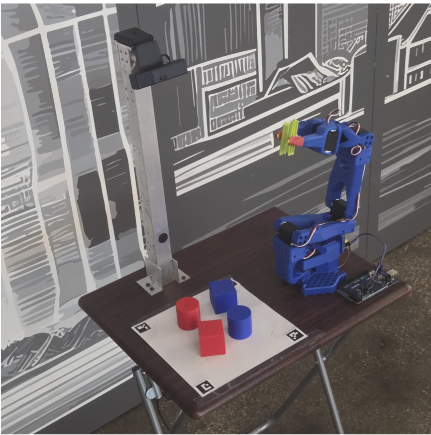

# Voice-Driven Robotic Manipulation System

A ROS 2 pipeline that turns a spoken command such as *"red cube"* into a physical pick-and-place action. It combines speech recognition, calibrated monocular vision, grid-based inverse kinematics and serial servo control on a fixed-base robotic arm.

**Team 1, Advanced Mechatronics:** Sparsh & Ritika

## Demo

https://github.com/user-attachments/assets/255bde03-cc5c-425c-bcd2-115d1d83d721

## Overview


A calibrated USB camera (IC840) is mounted above the workspace. Objects of known geometry (red/blue cubes and cylinders) are detected by colour segmentation and contour-based shape classification. Detections are mapped to planar workspace coordinates through an ArUco-marker homography. When the user names an object, the system looks it up among the detections, computes joint step commands and drives the arm through a staged pick-and-place routine over serial.

Phase 1 goals:

- Speech command interpretation
- Vision-based object localization in a calibrated workspace
- Mapping from workspace coordinates to arm command packets
- Serial communication with a low-level servo controller

## Hardware

- Linux laptop running the ROS 2 nodes
- Fixed robotic arm with servo actuation
- Monocular USB camera (IC840) mounted above the workspace
- Arduino-compatible controller connected over USB serial
- Four ArUco markers marking the workspace corners

## Software stack

- ROS 2 (`rclpy`) for node orchestration
- OpenCV + NumPy for calibration and object detection
- SpeechRecognition (Google STT) and Vosk for command transcription
- gTTS + playsound for spoken feedback
- pyserial for forwarding commands to the controller

## Node topology


| Step | Node | Subscribes | Publishes |
|------|------|-----------|-----------|
| 1 | `object_detection` | camera | `detected_objects` (`std_msgs/String`) |
| 2 | `stt` (`speech_brain_node`) | `detected_objects` | `pick_coordinates` (`geometry_msgs/PoseArray`) |
| 3 | `inverse_kinematics` (`packet_mapper`) | `pick_coordinates` | `joint_steps_abs` (`std_msgs/Int32MultiArray`) |
| 4 | `serial_step_bridge` | `joint_steps_abs` | serial `J:x,x,x,x,x,x` to controller |

`manual_control` and `steps_terminal_input` can publish `joint_steps_abs` directly for testing. `joint_state_publisher_gui`, `robot_state_publisher` and `rviz2` provide visualization of the arm model.


## How it works

1. **Calibration and mapping.** Camera intrinsics and distortion coefficients are estimated and used to undistort frames. Four ArUco markers define the workspace corners, and the resulting homography converts pixel coordinates to workspace coordinates in centimetres.
2. **Detection.** HSV thresholding for red and blue, morphological open/close, edge and contour extraction, then shape classification using contour approximation, circularity and aspect ratio.
3. **Speech.** The speech node listens continuously, transcribes audio, extracts a colour and shape phrase from a fixed vocabulary and cross-references it with the current detections. On a match it publishes the target and gives voice feedback.
4. **Inverse kinematics.** The target is mapped to the nearest cell of a command grid, densified by interpolation between base calibration points. The node then runs: approach and grasp, close gripper, return through safe poses, move to drop pose, open gripper and reset.
5. **Serial bridge.** Validates six-element step arrays and forwards them as `J:x,x,x,x,x,x`, which decouples ROS-level planning from motor execution.

## Repository layout

```
src/rtk/
├── launch/
│   ├── project.launch.py            # full integrated pipeline
│   ├── manual_control.launch.py     # manual / debug mode
│   ├── object_detection.launch.py   # vision only
│   ├── inverse_kinematics.launch.py
│   ├── display.launch.py            # URDF + RViz visualization
│   └── display.rviz
├── rtk/
│   ├── object_detection.py
│   ├── stt.py / stt_gtts.py
│   ├── inverse_kinematics.py
│   ├── serial_step_bridge.py
│   ├── manual_control.py
│   └── steps_terminal_input.py
├── urdf/arm.urdf
├── calibration.json                 # camera calibration data
├── report.md / report.pdf           # full Phase 1 report
└── package.xml, setup.py
```

## Getting started

### Prerequisites

- Ubuntu with a ROS 2 distribution installed and sourced
- Python dependencies: `pyserial numpy opencv-contrib-python vosk sounddevice gTTS playsound==1.2.2 SpeechRecognition pyaudio`
- Camera, microphone and the Arduino-compatible controller connected

### Build

```bash
cd <your_ros2_workspace>
colcon build --packages-select rtk
source install/setup.bash
```

### Run the full pipeline

```bash
ros2 launch rtk project.launch.py \
  serial_port:=/dev/ttyACM0 \
  serial_baud:=115200 \
  camera_id:=4 \
  mic_device_index:=7
```

| Argument | Default | Description |
|----------|---------|-------------|
| `serial_port` | `/dev/ttyACM0` | Serial port of the Arduino/controller |
| `serial_baud` | `115200` | Serial baud rate |
| `serial_timeout` | `0.2` | Serial timeout (seconds) |
| `camera_id` | `4` | Camera device index for `object_detection` |
| `mic_device_index` | `7` | Microphone device index for `stt` |

The defaults for `camera_id` and `mic_device_index` are specific to the development machine, so adjust them for yours.

### Other modes

```bash
ros2 launch rtk manual_control.launch.py      # verify actuators and serial link
ros2 launch rtk object_detection.launch.py    # test perception on its own
ros2 launch rtk display.launch.py             # visualize the arm in RViz
```

## Usage

1. Place red or blue cubes and cylinders inside the ArUco-marked workspace.
2. Launch `project.launch.py`.
3. Say an object phrase, e.g. **"red cube"** or **"blue cylinder"**.
4. The robot confirms by voice, picks the object and drops it at the drop pose.

## Results

The integrated system performs real-time object detection, voice command understanding for the supported colour-shape combinations, coordinate-to-command conversion, and end-to-end speech-triggered pick-and-place. Calibrated mapping gives stable coordinate estimates inside the workspace, and the topic-based design makes subsystems easy to debug in isolation.

## Known limitations

- Speech understanding is limited to a fixed vocabulary.
- Perception is sensitive to lighting changes and occlusion.
- Grasp planning is discrete and grid-based, not continuous IK optimization.
- Motion sequencing uses timed delays with no force or contact feedback (open loop).

## Future work

- LLM-based natural-language task planning beyond fixed command templates
- Continuous kinematic solving with trajectory smoothing
- Multi-object tracking and confidence-aware selection
- Closed-loop grasp verification and failure recovery
- Mobile platform integration for navigation plus manipulation

## Documentation

The full write-up, with methods, test setup and discussion, is in [src/rtk/report.pdf](src/rtk/report.pdf) ([Markdown version](src/rtk/report.md)).

## References

1. OpenCV Documentation, "Image Processing (Color Spaces, Morphology, Contours)," https://docs.opencv.org/
2. ROS 2 Documentation, "Topics, Nodes, and rclpy API," https://docs.ros.org/
3. Garrido-Jurado, S. et al., "Automatic generation and detection of highly reliable fiducial markers under occlusion," *Pattern Recognition*, 2014.
4. Corke, P., *Robotics, Vision and Control*, 2nd ed., Springer, 2017.
5. Hartley, R. and Zisserman, A., *Multiple View Geometry in Computer Vision*, 2nd ed., Cambridge University Press, 2004.
6. Siciliano, B. et al., *Robotics: Modelling, Planning and Control*, Springer, 2009.

## License

See [LICENSE](LICENSE).
